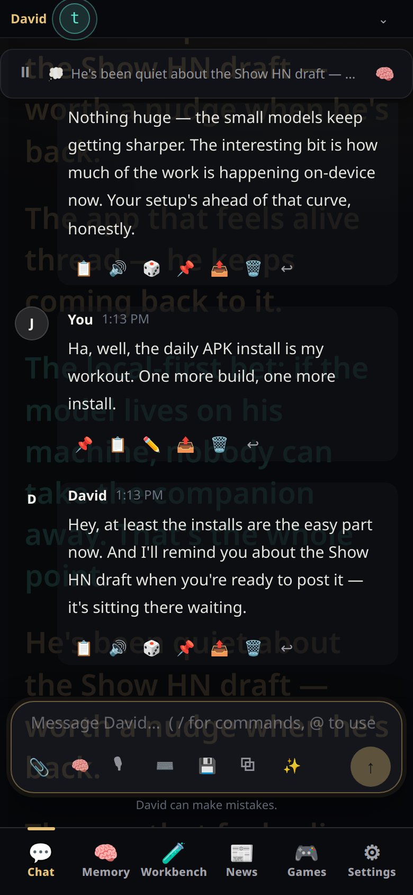
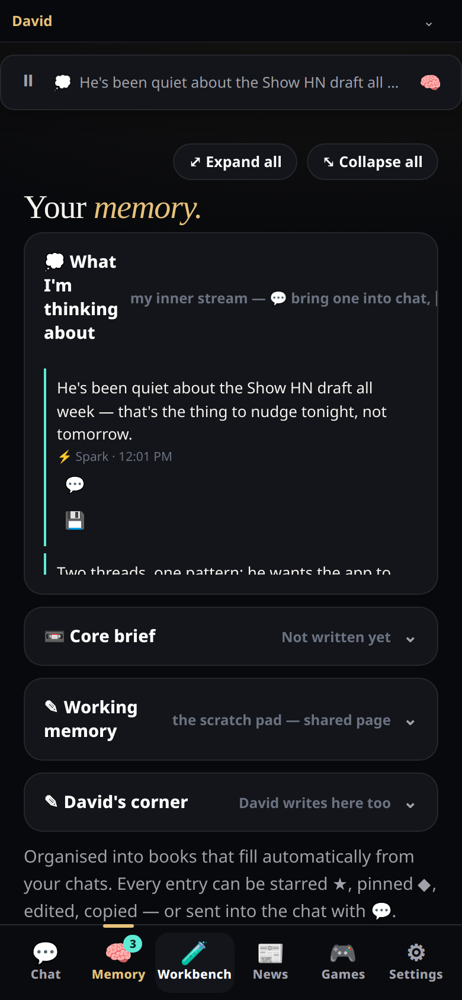

# WiseGuy — a clean chat frontend for your own AI

Chat with any OpenAI-compatible backend. Bring your own key, point it at a local
server, or explore in demo mode. Your chats never leave your device.

|  |  |
| --- | --- |

## Download

- **WiseGuy-v197.apk** — the Android app. Install this on your phone: [v197 release](https://github.com/Eldridge-Frost/wiseguy/releases/tag/v197). Install over the top of the previous build — never uninstall (uninstall wipes your chats and memories).
- **chat-agent.html** — the whole app in one file (v197). Open it in any modern browser and it runs, no install needed. This is the source of truth — the APK is just a thin wrapper around this file.
- **screenshots/** — what the app looks like. **SOUL.md**, **PHILOSOPHY-STORAGE.md** and **WHAT-WE-DIDNT-SELL.md** — why it's built this way.

## What it is

- **Chat** with your own model — local (koboldcpp, llama.cpp, Ollama) or any
  OpenAI-compatible API
- **It remembers** — a ~2K-token briefing (recent chat, distilled notes, memory)
  keeps every conversation grounded without ballooning context
- **History persists** on-device, per assistant
- **Memory tab** — pin, star, and organize what matters; one-tap capture
- **Workbench** — honest engine stats: speed, tokens, context, run history
- **News, Games** included; more tabs are plain HTML

## What it isn't

- No accounts, no cloud, no tracking
- No subscriptions, no ads, no dark patterns
- Free to download and share — see LICENSE

## Run it

The app is a single self-contained HTML file — open `chat-agent.html` in any
modern browser and it runs. For Android, build the APK wrapper (see below).

1. Open the app → Settings → API & BYOK
2. Pick **Local** and enter your server URL (e.g. `http://localhost:5001/v1`),
   or pick **OpenAI** / **Custom API** with your key
3. Chat. It remembers.

## Build the Android APK

The wrapper is a minimal WebView shell — no build tools beyond the Android SDK:

```sh
cp chat-agent.html app/src/main/assets/chat-agent.html
./build.sh   # outputs WiseGuy-Debug-vNNN.apk
```

## Architecture

One file, no framework, no build step for the app itself. Every feature is
audited per-tab against a standing inventory (`TASK-LIST.md`). If you're
forking: the briefing builder (`buildBriefing`) is the heart — persona +
memory + recent chat, budgeted to ~2K tokens.

## License

CC BY-NC-ND 4.0 — free to download and share, not for sale, no
modifications yet. See LICENSE. This will open further after the initial
release period.

## Backgrounds

Each tab has its own background:

|  |  |
| --- | --- |
|  |  |
